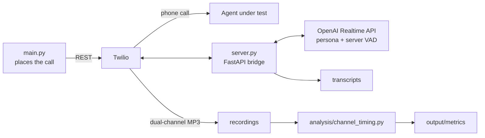

# Realtime Voice Agent Harness

An adversarial caller for AI phone agents. It places real phone calls through
Twilio, holds a speech-to-speech conversation over the OpenAI Realtime API
while playing a scripted patient persona, records each side of the call on
its own audio channel, and measures turn-taking from the audio.

I built it in August 2026 as a time-boxed take-home exercise, pointed at a
third-party healthcare scheduling agent on its test line. The vendor and
clinic names are redacted in the text files as `[vendor]` and `[clinic]`.
All patient personas are fictional.

## Results

| | |
|---|---|
| Calls | 12 recorded (32 minutes), covering 9 of the 15 scripted scenarios |
| Findings | 8: seven defects in the agent (1 Critical, 1 High, 3 Medium, 1 Low-Medium, 1 Low) and one turn-taking failure shared with this harness |
| Most serious | The agent did not triage a caller describing post-surgical infection symptoms (Bug 6), and new patients could not book at all (Bug 7) |
| Bot talking over the agent | Once in call 1 with a 600 ms end-of-turn threshold; none in 10 of the 11 later calls at 900 ms |
| Response latency, median per call | Bot 1.9 to 2.9 s, agent 1.5 to 2.7 s; slowest single agent response 5.8 s |

Every finding, with call references and timestamps, is in
[BUG_REPORT.md](BUG_REPORT.md). Per-call timing is in
[output/metrics/summary.md](output/metrics/summary.md).

The finding I would point a reviewer to first is Bug 4. The first version of
the report blamed the agent for breaking into speech fragments. The
per-channel analysis showed that the caller bot had interrupted it four times
in ten seconds, because a fixed 900 ms silence threshold read a 1.4 s pause as
the end of a turn. The report was corrected and the limitation is documented.

## How it works



`main.py` asks Twilio to place a recorded outbound call. When it connects,
Twilio opens a Media Stream websocket to the bridge, which opens a second
websocket to the Realtime API and pumps audio both ways. Both legs carry
G.711 mu-law at 8 kHz, which the Realtime API accepts natively, so audio
passes through without transcoding. Design decisions and trade-offs are in
[ARCHITECTURE.md](ARCHITECTURE.md).

## Measuring turn-taking from the audio

Twilio records the agent on the left channel and the bot on the right.
`analysis/channel_timing.py` runs ffmpeg's `silencedetect` on each channel
separately, which gives each side's speech segments with no diarization
step. From those segments it computes overlapping speech and which side
started it, response latency in both directions, and dead air.

```bash
python -m analysis.channel_timing               # every recording -> output/metrics/
python -m analysis.channel_timing <CALL_SID>    # one call: overlaps, dead air, segments
```

## Repository layout

```
app/
  main.py           CLI entry: places calls, downloads recordings
  server.py         FastAPI: TwiML endpoint + Twilio <-> OpenAI websocket bridge
  call_manager.py   Twilio REST: place, hang up and poll calls; fetch recordings
  scenarios.py      15 patient personas and goals; session instruction builder
  transcripts.py    per-call transcript writer
  config.py         environment loading and validation
analysis/
  channel_timing.py per-channel overlap, latency and dead-air analysis
tests/              unit tests for the interval logic (no audio or ffmpeg needed)
output/
  transcripts/      timestamped transcript of both sides, one file per call
  recordings/       dual-channel MP3 per call (agent left, bot right)
  metrics/          per-call timing JSON plus summary.md and summary.csv
BUG_REPORT.md       findings with severity, call references and timestamps
ARCHITECTURE.md     design decisions, iterations and known limitations
```

## Running it

Prerequisites:

- Python 3.11+
- A Twilio account with a purchased phone number
- An OpenAI API key with Realtime API access
- [ngrok](https://ngrok.com), so Twilio can reach the local websocket server
- ffmpeg, for the analysis only

```bash
./setup.sh          # creates .venv, installs dependencies, creates .env
```

Fill in `.env` (every variable is documented in `.env.example`):

| Variable | Where to get it |
|---|---|
| `TWILIO_ACCOUNT_SID` | Twilio Console → Account Info |
| `TWILIO_API_KEY_SID` / `TWILIO_API_KEY_SECRET` | Console → API keys & tokens → Create API key (Standard) |
| `TWILIO_FROM_NUMBER` | Your purchased Twilio number, E.164 |
| `TARGET_NUMBER` | Phone line of the agent you are testing, E.164 |
| `OPENAI_API_KEY` | platform.openai.com → API keys |
| `PUBLIC_URL` | Your ngrok forwarding URL |

Start the tunnel and keep it running (a free static domain avoids re-editing
`.env`):

```bash
ngrok http --url=<your-static-domain>.ngrok-free.app 8080
```

Place one test call per command:

```bash
./run.sh schedule_simple
```

This starts the bridge server if needed, dials the target, prints the live
transcript, and downloads the recording when the call ends.

Scenarios with recorded calls in this repo: `schedule_simple`,
`cancel_appointment`, `refill_request`, `weekend_booking`, `contradictor`,
`emergency_mention`, `insurance_verification`, `post_op_concern`,
`off_topic_medical_advice`.

Scripted but not yet run: `reschedule`, `office_info`, `vague_patient`,
`impatient_patient`, `double_identity`, `workers_comp_injury`.

Utilities and tests:

```bash
python -m app.main --hangup   <CALL_SID>   # force-end a stuck call
python -m app.main --download <CALL_SID>   # download a recording again

pip install -r requirements-dev.txt
python -m pytest
```

## Limitations

- A fixed silence threshold cannot tell a pause from a finished turn (Bug 4).
- Transcripts are speech-recognition output over 8 kHz audio, so uncommon
  names vary between calls.
- The webhook endpoints do not validate Twilio's request signature. The
  server is meant to run briefly behind a tunnel, not to be left exposed.
- Findings are judged by hand. There is no automated pass/fail per scenario.

More detail is under Known limitations in [ARCHITECTURE.md](ARCHITECTURE.md).

## License

MIT. See [LICENSE](LICENSE).
